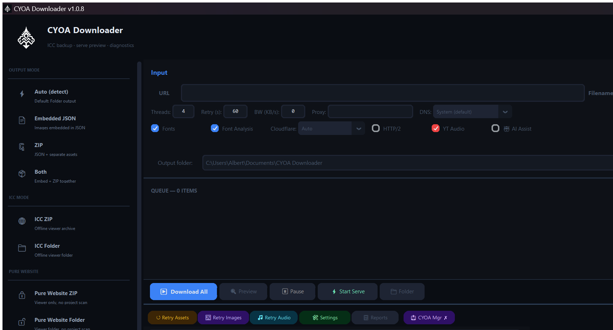

<p align="center">
  <picture>
    <source media="(prefers-color-scheme: dark)" srcset="assets/logo-dark.png">
    
  </picture>
</p>

<h1 align="center">CYOA Downloader</h1>

<p align="center">
  Back up interactive CYOA projects and websites for offline use.
  Includes a desktop GUI, CLI, batch queues, media recovery, and local previews.
</p>

<p align="center">
  <a href="https://github.com/Halo1211/CYOA-Downloader/actions/workflows/ci.yml"></a>
  <a href="https://github.com/Halo1211/CYOA-Downloader/releases/latest"></a>
  
  <a href="LICENSE"></a>
</p>

> Download only content you are permitted to access and retain. This independent
> community tool is not affiliated with CYOA.CAFE or the websites it downloads.

<p align="center">
  
</p>

## Features

- Save ICC/CYOA projects as embedded JSON, a ZIP with local assets, or both.
- Archive viewer websites and custom JavaScript sites as folders or ZIPs.
- Follow story routes, capture runtime assets, and recover images, fonts, and audio.
- Import and export batch queues; retry failed downloads and verify output files.
- Modernize compatible offline viewers while preserving original files.
- Configure proxies, DNS, Cloudflare recovery, and an optional VPN interface guard.
- Browse CYOA Manager libraries and serve downloaded projects locally.

## Quick start

### Windows executable

1. Download `CYOA-Downloader-Windows-x64.zip` from
   [GitHub Releases](https://github.com/Halo1211/CYOA-Downloader/releases/latest).
2. Extract it and run `CYOA Downloader.exe`.
3. Open **Diagnostics** and check the requirements for your chosen features.
4. Paste a project URL, choose an output mode, and select **Download All**.

The executable is unsigned; Windows SmartScreen may require confirmation.
FFmpeg, JavaScript runtimes, browser installations, and RAR helpers are external
dependencies. Missing optional helpers affect only the related features.

### Run from source

Requires Python 3.10 or newer. On Windows:

```powershell
py -3 -m venv .venv
.\.venv\Scripts\Activate.ps1
python -m pip install --upgrade pip
python -m pip install -r requirements.txt
python cyoa_downloader.py --dependency-check
python cyoa_downloader.py
```

On Linux or macOS, use `python3 -m venv .venv` and
`source .venv/bin/activate`, then run the remaining commands above. Linux GUI
installs also need Tk, usually available as the `python3-tk` system package.

Additional integrations and browser support:

```powershell
python -m pip install -r requirements-optional.txt
python -m playwright install chromium
```

## Choose an output

| Output | Use |
| --- | --- |
| Embedded JSON | A project with supported assets embedded as data URIs |
| ZIP / Both | A project with separate local assets, optionally also embedded JSON |
| ICC Folder / ICC ZIP | An ICC viewer website and its project assets |
| Pure Website Folder / ZIP | A custom website without requiring ICC project data |
| CYOAP Vue Folder / ZIP | A dedicated backup workflow for CYOAP Vue projects |

For an unfamiliar JavaScript site, choose **Pure Website Folder**, open
**Settings → JavaScript Archive Policy**, and select **Auto**. Set the page and
depth caps, add the URL, and download. Use **Serve** to open the result through
local HTTP; modules, fetch, and service workers may fail under `file://`.

| Archive strategy | Behavior |
| --- | --- |
| Classic | Saves the entry page and statically discoverable assets |
| Smart | Adds a bounded same-origin story-route crawl |
| Browser | Adds JavaScript rendering, lazy-load capture, and optional safe interaction |
| Auto | Profiles the site and selects a suitable workflow |

Limits are safety caps, not download targets. Safe interaction permits a narrow
allowlist of controls and blocks forms, mutation requests, and risky actions.
Sites that require a private backend may not work completely offline.

## CLI examples

```powershell
# Embedded project
python cyoa_downloader.py "https://example.com/story/" -o "output"

# Project ZIP and embedded JSON
python cyoa_downloader.py "https://example.com/story/" --both -o "output"

# Custom website folder
python cyoa_downloader.py "https://example.com/story/" `
  --pure-website-folder --archive-strategy auto `
  --archive-max-pages 800 --archive-max-depth 30 -o "output"

# Batch queue
python cyoa_downloader.py --list "examples/batch_urls.csv" -o "output"

# Check an individual completed package and write checksums
python cyoa_downloader.py --verify "output/story_site" --write-manifest
```

Run `python cyoa_downloader.py --help` for all options. Queue mode editing,
CSV/TXT export, and import formats are covered in the
[GUI queue guide](docs/GUI_QUEUE_GUIDE.md).

## Offline viewer modernization

Automatic viewer injection and modernization are **off by default**. Enable
them independently under **Settings → Viewers**. **Auto** checks source HTML,
then the project schema, to select ICC Original, ICC Plus Legacy, ICC Plus 2,
ICC Remix, or a compatible Lt. Ouroumov viewer.

Register a viewer ZIP, RAR, or unpacked folder. ICC Plus 2 requires a matching
local, offline, or standalone runtime. To modernize an existing library:

```powershell
python cyoa_downloader.py `
  --modernize-library "E:\CYOA" `
  --viewer-collection "E:\CYOA Viewer Collection" `
  --modernize-output "E:\CYOA\_edited"
```

The destination must be absent or empty. The original library is preserved;
`conversion_report.json` records results. Replaced runtime files are backed up
under `__original_site__`, and publisher-specific assets are retained.
See the [JavaScript archive guide](docs/JAVASCRIPT_ARCHIVE_GUIDE.md) for
compatibility, runtime limits, output structure, and troubleshooting.

## Network and credentials

Open **Settings → Network** for manual or environment proxies, per-scheme
overrides, bypass hosts, UDP/TCP/DoH/DoT DNS, and the VPN guard. **Validate
offline** checks configuration and local interfaces without probing a website.
The guard checks an existing VPN interface; it does not create a VPN tunnel.
See the [network guide](docs/NETWORK_GUIDE.md) for configuration examples.

Expired Discord attachment URLs can be refreshed with a bot token supplied
through **Settings / Maintenance**, `DISCORD_BOT_TOKEN`, or `--discord-token`.
Read the [Discord attachment recovery guide](docs/DISCORD_ATTACHMENTS_GUIDE.md).

Active settings live in `~/.cyoa_downloader/settings.json`. Portable export
removes secret fields, but active settings may contain credentials. Never
commit settings, tokens, API keys, cookies, or downloaded content.

## Optional integrations

- **CYOA Manager:** browse local libraries, queue source URLs, or select
  **Serve Local** for a saved project. JSON-only entries receive a local viewer.
- **Serve Tools:** preview helpers, including the optional cheat panel, operate
  in the local browser session. Attribution is listed in [Credits](CREDITS.md).
- **itch.io:** enable the GUI downloader or use `--itch-only` with an installed
  `itch-dl` backend and an `ITCH_API_KEY`. HTML5 ZIPs receive cached offline
  folders; original archives are retained.
- **Media recovery:** YouTube extraction may require current `yt-dlp`,
  `yt-dlp-ejs`, Deno or another supported JavaScript runtime, and FFmpeg.

## Troubleshooting

```powershell
python cyoa_downloader.py --version
python cyoa_downloader.py --dependency-check
python cyoa_downloader.py --self-test
```

For incomplete downloads, inspect `backup_report.txt`, `failed_assets.txt`,
`failed_images.txt`, or `skipped_youtube_audio.txt`, then use **Verify**,
**Retry Assets**, **Retry Images**, or **Retry Audio**. Missing assets retain
their original references; the downloader does not generate placeholders.

Include your version, output mode, reproduction steps, and sanitized logs in
[a bug report](https://github.com/Halo1211/CYOA-Downloader/issues/new/choose).
Report security issues through the process in [SECURITY.md](SECURITY.md).

## Development and Windows builds

```powershell
python -m pip install -r requirements-dev.txt
python -m compileall -q cyoa_downloader_app cyoa_downloader.py
python -m pytest -q
python -m ruff check .
```

The suite covers GUI/CLI dispatch, downloads, packages, network settings,
storage, previews, and integrations. To run optional live checks, set
`CYOA_GUI_SMOKE=1` and `CYOA_RUNTIME_SMOKE=1` with a graphical desktop and
installed Playwright Chromium. Run a focused group with `pytest -k`, such as
`python -m pytest -q -k discord_attachments`.

Build a Windows executable and ZIP with:

```powershell
.\tools\build_windows.ps1
```

The output is `dist\CYOA-Downloader-Windows-x64.zip`. Read
[CONTRIBUTING.md](CONTRIBUTING.md) before submitting changes and
[CHANGELOG.md](CHANGELOG.md) for release history. CYOA Downloader is available
under the [MIT License](LICENSE).
